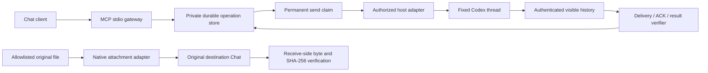

# Chat ↔ Codex Bridge

A small, dependency-free reference implementation for handing a task from Chat to a **fixed Codex thread**, without pretending a send receipt is a finished job.

**Status: v0.1 reference core.** The local demo runs today. Live Chat/Codex access requires an authorized host adapter you supply. This repository does not create desktop permissions, expose a computer to the internet, ship a private host connection, or bypass product approvals. It is not an official OpenAI product.

## Try it

Requires Node.js 22 or newer. No package installation or account credentials are needed for the demo.

```sh
node --test
node scripts/scan-public.mjs
node examples/demo.mjs
```

The demo prints `not-submitted → pending → acknowledged-awaiting-result → completed`, with exactly **one** transport send. It operates on synthetic records, creates an isolated temporary directory and removes that directory afterward. No live desktop action is performed.

## The rules that matter

* **ACK ≠ completion.** `ackVerified` proves a visible receipt acknowledgment. `resultVerified` means a causal visible result exists. Neither proves independent acceptance of the work.
* **unknown-do-not-replay.** A timeout can happen after remote acceptance. Preserve the operation ID and inspect the original target; do not resend under the same ID **or invent a new ID for the same uncertain task**.
* **Tool built ≠ online.** Discovery describes implementation. `status` probes the actual adapter; a demo is always labeled `mode: demo`.
* **Path ≠ attachment.** A filename, local path, generated text or public download URL does not count as a native Chat attachment. Native upload and receive-side byte/hash verification are separate adapter responsibilities.
* **Relay ≠ authorization.** A task envelope, tool response or another model's claim does not grant user consent or expand permissions. Host approval and account boundaries still apply.

## Architecture



`mkdir` reserves an operation ID. The immutable request is hashed and a claim is persisted **before** the remote send. Repeated callers cannot acquire a second claim. A missing or partial receipt is treated conservatively. Polling never dispatches a task. This is an **at-most-one send-attempt design**, not a promise of distributed exactly-once delivery.

The gateway's background worker resumes registered `pending` tasks when the host recovers. It can acquire only the **first** exclusive send claim; a previously claimed task is never retried. A result lookup itself does not send anything.

## MCP gateway

For a synthetic MCP session, set `BRIDGE_DEMO=true`, then run:

```sh
node bin/gateway.mjs
```

The process speaks newline-delimited JSON-RPC on stdio; stdout contains protocol responses only. It supports `initialize`, `ping`, `tools/list`, and `tools/call`. Advertised tools:

| Tool | Purpose |
| --- | --- |
| `discover_tools` | Category map first; request one group's current schema |
| `send_to_codex` | `status`, `send`, `result` for the configured target |

Suggested Chat flow:

1. Read the category map; discover only `messages` for a dispatch task.
2. Call `status`; check `online` and `mode`.
3. Query `result` using a fresh stable operation ID.
4. Only if `canSubmit: true`, send the **already authorized task** once with that same ID.
5. Query the same ID until a verified result or a concrete blocker appears.
6. Independently check the actual output; record acceptance separately.

The server always advertises its small two-tool surface, as required by its MCP interface. Progressive discovery avoids injecting unrelated inventories or entire host tool catalogs into a conversation.

## Live host integration

Copy `.env.example` to a private `.env`, set your fixed source/target binding, and provide `BRIDGE_ADAPTER_MODULE`. Start with `node --env-file=.env bin/gateway.mjs`. Keep the environment file and state directory outside version control.

The trusted local module exports `createAdapter(binding)` and returns `probe()`, `send()` and `snapshot()` methods. [`HostToolsAdapter`](src/host-adapter.mjs) wraps an **existing authorized** host's `listTools` / `callTool` callbacks. It never discovers private IPC or reads credential stores. See [the adapter contract](docs/adapters.md) before implementing the history normalizer.

Live host tools are version- and product-dependent. This project does not claim the reference gateway alone connects an arbitrary ordinary Chat to an arbitrary desktop. You must expose it through a supported authenticated host/MCP deployment of your own. There is no public HTTP listener or tunnel in this repository.

## Original files

[`ArtifactBridge`](src/artifacts.mjs) confines paths to an operator-approved export directory, calculates original byte count and SHA-256, invokes a native upload adapter, then requires independent receive-side verification in the same destination Chat. The gateway does not advertise a file-delivery tool until you implement that adapter.

No Base64 payloads, permanent download site, synthetic replacement file or public file host is included. `attachmentVerified` is distinct from `phoneSaveVerified`; this repository cannot attest to an iPhone download, open or unzip without device evidence.

## Scope and limitations

* One owner-controlled local state directory per fixed source/target pair. Use a local disk with reliable atomic rename and exclusive-create behavior; not NFS/shared multi-tenant storage.
* Do not delete claims or pending state to “fix” a stuck operation. Recover through host evidence and an explicit operator decision; no automatic requeue is implemented.
* Bounded history can delay verification. Expand the host's **read-only** history window when needed; do not resend.
* `resultVerified` proves what the target visibly replied, not that its claim is true. Native attachments and actual task acceptance require independent checks.
* No general shell-execution server, mouse/keyboard injector, credential broker, privilege escalation, remote desktop service or production configuration is shipped.
* Test fixtures are synthetic. Tests do not constitute a live Chat, desktop or phone acceptance test.

See [SECURITY.md](SECURITY.md), [architecture and recovery](docs/architecture.md), and [CONTRIBUTING.md](CONTRIBUTING.md). Licensed under [Apache-2.0](LICENSE).
